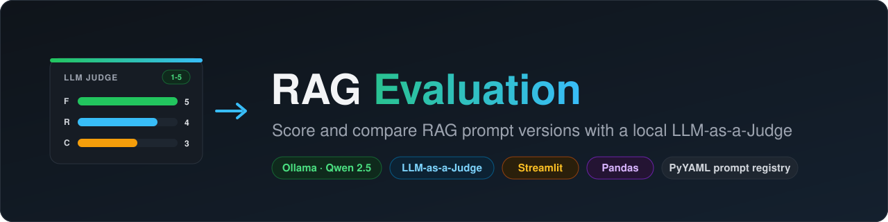
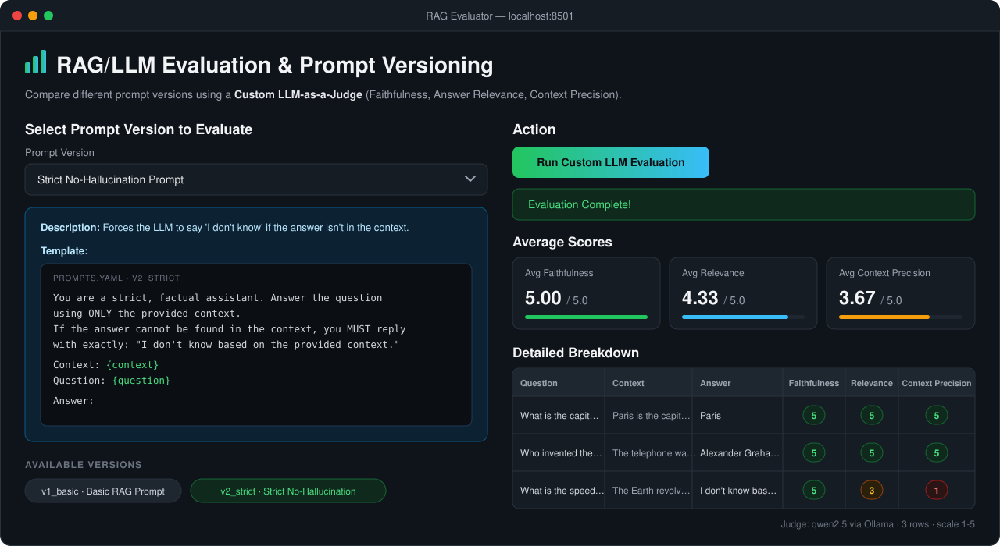
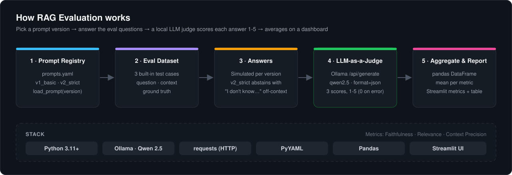

<p align="center">
  
</p>

<p align="center">
  
  
  
  
  
</p>

\# 📊 RAG/LLM Evaluation \& Prompt Versioning


A custom, dependency-free LLM evaluation system that scores RAG prompts using a local LLM-as-a-Judge. Compare different prompt versions using metrics like Faithfulness, Answer Relevance, and Context Precision.

<p align="center">
  
  <br><sub>Streamlit dashboard: pick a prompt version, run the local LLM judge, and review average and per-question scores (1-5) for Faithfulness, Relevance and Context Precision.</sub>
</p>


\## ✨ Key Features

\- \*\*Custom LLM-as-a-Judge:\*\* Built from scratch using direct Ollama API calls (no fragile external evaluation libraries).

\- \*\*Prompt Versioning:\*\* YAML-based registry to track and compare different prompt templates.

\- \*\*100% Local \& Free:\*\* Powered by Ollama (Qwen 2.5) for zero-cost, private evaluation.

\- \*\*Scientific Metrics:\*\* Evaluates Faithfulness (no hallucinations), Answer Relevance, and Context Precision.

\- \*\*Beautiful Dashboard:\*\* Streamlit UI displays average scores and detailed breakdowns.


\## 🛠️ Tech Stack

\- \*\*Python 3.11+\*\*

\- \*\*Ollama\*\* (Local LLM inference with Qwen 2.5)

\- \*\*Streamlit\*\* (Interactive Web UI)

\- \*\*Pandas\*\* (Data analysis)

\- \*\*PyYAML\*\* (Prompt versioning)


## ⚙️ How It Works

<p align="center">
  
</p>

A sample of the evaluation output structure is in [`samples/sample_report.json`](samples/sample_report.json).


\##  Getting Started


\### Prerequisites

1\. Install \[Ollama](https://ollama.com/download) on your machine.

2\. Pull the evaluation model:

&nbsp;  ```bash

&nbsp;  ollama pull qwen2.5

